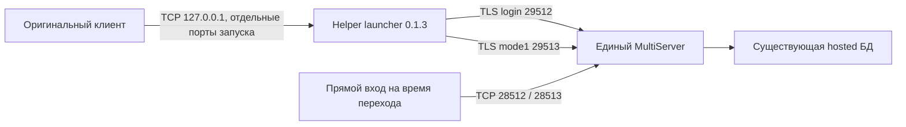

# Игровой TLS — реализация и эксплуатация

Статус 7 октября 2026: оба TLS-канала установлены на действующий хостинг, launcher 0.1.3 опубликован. Полная публичная HTTPS-загрузка подтвердила размер и SHA256. Два настоящих графических клиента на одном компьютере за одним public IP прошли описанные ниже проверки. Итоговый [acceptance.json](reports/game-tls/acceptance.json) отдельно учитывает автоматические TCP-проверки, действия native UI и оставшиеся ограничения.

## Подключение игрока

Launcher 0.1.3 открывает TCP к `185.184.42.88:29512` и `185.184.42.88:29513`, проверяя TLS для имени `ti-reborn.com`, перед запуском игры. Адрес TCP задан отдельно, поскольку DNS домена проходит через web proxy. .NET `SslStream` использует системную проверку цепочки, имени сертификата и отзыва; после согласования допускаются TLS 1.2/1.3. При ошибке сертификата или TLS автоматического перехода на старые порты нет.

На каждый запуск helper выделяет два собственных свободных порта исключительно на `127.0.0.1`. Оригинальный ORANGE направляется на них проверенным изменением памяти собственного процесса до первого игрового подключения. Клиентские файлы и `autoexec.cfg` этим маршрутом не изменяются. Два клиента на одном компьютере получают разные пары loopback-портов.

Helper живёт вместе со своим игровым процессом. Закрытие окна launcher оставляет игру и мост работающими; завершение игры освобождает listeners и каналы. Завершение helper, ошибка подключения или проверки TLS и фатальный отказ listener закрывают Windows Job Object только назначенной ему игры. После успешно проверенного TLS обычное закрытие или сброс одного канала завершает только этот relay: мост сохраняется для перехода ORANGE из mode0 в mode1 и переподключения. Чужие игровые процессы не входят в этот Job Object.

Старые версии launcher не обновляют свой EXE. Нужно закрыть игру и launcher 0.1.2 и заменить исполняемый файл опубликованным 0.1.3 из [официальной загрузки](https://ti-reborn.com/downloads/TIO-Launcher.exe). Размер файла — 118679712 байт; SHA256 — `8a34ea68124eebfb6ded5f2c9d8c96dee85befb9eb99b5efb57d5dea708b4d52`. Версия launcher отличается от версии ресурсов клиента: существующий публичный client manifest `2026.10.07.4` этой поставкой не изменён. См. [проверку полной HTTPS-загрузки](reports/game-tls/public-https-download.json).

## Общий backend и протокол

Оба TLS listener работают в том же `MultiServer`, что прямые входы 28512/28513. Сохраняются общие аккаунты, БД, очередь, арена, чат, ограничения входа и лимит 16 авторизованных аккаунтов. Сервер использует фактический peer IP; клиент не передаёт адрес для подмены origin.



После TLS handshake канал login передаёт фиксированный 8-байтовый bridge preface: ASCII `TIOT`, версия `01`, flags `00`, порт второго loopback-канала как `uint16` big-endian. Допустимы порты 1024–65535; адрес server list всегда `127.0.0.1`. Далее сохраняются исходные framing и codec TIO. Mode1 не имеет preface: сервер первым отправляет обычный native challenge.

Handoff остаётся одноразовым, действует десять секунд и привязан к реальному IP. Сервер также проверяет тип транспорта: TLS-login нельзя продолжить через direct-mode1, direct-login нельзя продолжить через TLS-mode1. Неверная попытка не расходует допустимый token другого маршрута.

Ресурсные ограничения применяются до TLS handshake. Незавершённые TLS-сокеты резервируют общие admission slots; криптографическая часть и preface выполняются отдельными ограниченными workers с общим deadline. После успешной подготовки соединение передаётся существующему игровому worker. Slow handshakes не выполняются в основном цикле арены.

Локальная конфигурация оставляет TLS выключенным. Для общего сервера используется:

```toml
multi_account = true
session_port = 28513

[tls]
enabled = true
login_port = 29512
session_port = 29513
certificate = "/etc/tio-server/tls/current/fullchain.pem"
private_key = "/etc/tio-server/tls/current/privkey.pem"
handshake_timeout_seconds = 5
max_handshakes = 4
```

Все четыре внешних порта должны различаться. Прямые публичные 28512/28513 сохраняются на время перехода; их закрытие требует отдельного шага после приёмки обновлённых клиентов и проверки отката.

## Сертификат и обновление

Игровой сертификат соответствует DNS SAN `ti-reborn.com`. Закрепления leaf fingerprint в launcher нет. Краткоживущий IP-сертификат HTTPS из первоначального проекта больше не определяет игровой endpoint.

`deploy/renew_game_tls.py` принимает renewal только `/etc/letsencrypt/live/ti-reborn.com`; события других lineage игнорируются. Hook создаёт отдельную неизменяемую пару сертификат/ключ в `/etc/tio-server/tls/versions/`, проверяет ключ, срок и domain SAN, затем атомарно заменяет symlink `current`. Каталоги принадлежат `root:tio` с правами 0750, файлы — `root:tio` 0640. Игровой пользователь получает доступ только к выделенным копиям; ключи не передаются в клиент, отчёты или за пределы VPS.

`systemctl reload tio-server` отправляет SIGHUP. Backend повторно разрешает общий symlink-каталог, проверяет целую пару и сроки, создаёт новый `SSLContext` и только после успеха заменяет контекст новых соединений. Действующие `SSLSocket` сохраняют прежний контекст. Повреждённая, изменившаяся во время чтения или просроченная пара оставляет старый рабочий контекст; ошибка reload отмечается в журнале.

Проверка сертификата, renewal и журнал:

```bash
/opt/tio-emulator/.venv/bin/python /opt/tio-emulator/deploy/renew_game_tls.py --check-only
systemctl reload tio-server
journalctl -u tio-server --since '-10 minutes' --no-pager
```

При исправной ротации новые подключения получают новый сертификат, существующие игровые соединения продолжаются. Ошибка обновления требует устранения до истечения действующего сертификата.

## Поставка и откат

`tools/prepare_game_tls_deploy.py` читает фактические исходники, конфигурацию, launcher и клиентский manifest VPS, сохраняет baseline hashes и собирает точный allowlist обновления. `tools/deploy_game_tls_remote.py` повторно проверяет baseline, отсутствие игровых соединений, сохраняемых боёв и отложенных расчётов.

Перед изменениями резервируются текущая удалённая SQLite, предыдущие код/config/systemd, launcher и manifest. Архив обновляет только разрешённый код; локальные игровые данные не входят в него. Отдельный этап `--publish-launcher` заменяет скачиваемый EXE после проверки backend и клиентов. Клиентский manifest при этой поставке не меняется.

Если после серверной поставки подготовлен уточнённый EXE, публикация принимает только явно выбранный `--launcher-candidate` вместе с `--launcher-sha256`. Это root-owned обычный файл внутри `/root`, 1–200 MiB. Его снимок сверяется с указанным SHA256 до изменения состояния публикации. Исходный архив, deployed server hashes, старые launcher/manifest и manifest резервной копии продолжают проверяться; первоначальный backup manifest не заменяется. Опубликованный candidate и его фактические hash/размер записаны в [publication.json](reports/game-tls/publication.json).

После публикации `tools/publish_game_tls_download_metadata.py` привёл страницу загрузки к launcher `0.1.3`, размеру 118679712 байт и версии публичного client manifest `2026.10.07.4`. Перед записью создан свежий полный PostgreSQL dump с правами 0600 и сохранена прежняя строка `DownloadVersion/main`. Транзакция проверила прежнюю строку целиком и изменила только четыре поля версии/размера/даты; количество web-аккаунтов осталось 3, записей аккаунтов не было. Scoped rollback этого metadata восстанавливает только эти поля после проверки текущей строки, без восстановления всей PostgreSQL БД. См. [отчёт обновления metadata](reports/game-tls/portal-download-publication.json) и [проверку публичной страницы](reports/game-tls/public-download-page.json).

Откат восстанавливает прежние код/config/launcher и только добавленные TLS firewall rules. Он **сохраняет текущую hosted БД**, включая аккаунты и результаты, появившиеся после поставки. Наличие резервной БД не означает её автоматического восстановления.

Резервная копия поставки находится на VPS в `/root/tio-before-game-tls-jzzbxmdu`. При обновлении кода все 62 существующие таблицы и 177 игровых аккаунтов сохранены; локальная БД не загружалась. Последующие QA-покупки и расчёт боя выполнялись обычным протоколом только для двух собственных тестовых аккаунтов. После штатного выхода проверка БД — `ok`, checkpoints и отложенных расчётов — 0. Итоговые `tio-server`, `tio-portal`, `tio-game-api` и `nginx` активны: [hosted-health-final.json](reports/game-tls/hosted-health-final.json).

## Доказательства и границы проверки

- `tests/test_game_tls.py`: реальный backend и временная SQLite, два TLS-аккаунта за одним IP, разные loopback session ports, handoff/replay/transport isolation, bootstrap deadlines, shared admission, shutdown и reload без разрыва действующего соединения.
- `tests/test_game_tls_deploy.py`: неправильный SAN, несовпадающий ключ, expiry, другой lineage, allowlist/hashes/baseline, active-player guard, права конфигурации, сохранение БД при rollback и отложенная публикация launcher.
- `reports/game-tls/launcher-tls-tests-relay-reset.txt`: семь групп Windows `SslStream`: неправильный issuer/SAN/expiry, два моста, четыре loopback-порта, preface, отдельные TCP-адрес и TLS-имя, завершение relay, штатный mode0 RST при работающем mode1 и отказ без fallback. `launcher-updater-tests-relay-reset.txt` подтверждает шесть проверок обновлятора окончательного EXE.
- `reports/game-tls/linux-isolated-tests.json`: проверки symlink-ротации и renewal в отдельном Linux-каталоге; настройки основной службы не менялись этим тестом.
- `tools/verify_game_tls_hosted.py`: отдельная автоматическая проверка обоих внешних TLS-каналов, состояния двух аккаунтов, общего боя и reconnect. Она не запускает графические клиенты.
- `reports/game-tls/QA.md`: протокол приёмки launcher-owned графических клиентов и ограниченного capture четырёх игровых портов; plaintext и TLS keys в отчёт не записываются.

Фактическая приёмка [acceptance.json](reports/game-tls/acceptance.json) подтверждает:

- Автоматически: полный Python suite — 975 тестов PASS; отдельные TLS, deployment, metadata, Windows launcher/updater и независимые x86 bootstrap/route checks; публичные пробы TLS 1.2/1.3 на обоих портах; два аккаунта, общий авторитетный бой и reconnect через TLS 1.3.
- Настоящие клиенты: два независимых helper и разные loopback-порты, login/mode1/персонаж/мир; native-покупка B — 50 патронов Ammo 9mm; общий бой загружен обоими графическими клиентами. B переместился `(35,6) → (35,7)`, ОД `15 → 14`; сообщение B видно у A. Новый native-процесс B после перезапуска вернулся в тот же бой с прежними identity/map/позициями/HP/inventory.
- Жизненный цикл: закрытие launcher сохранило игру и helper; отказ helper завершил только его игру; завершение native-клиента освободило его каналы. В конце все собственные QA-процессы и loopback-listeners закрыты.
- Внешний capture четырёх портов: 20 TLS flows, включая native helpers и четыре protocol setup flows, без наблюдаемых соединений к legacy-портам и без plaintext credential patterns. TLS keys не записывались, расшифрование не выполнялось, raw capture остаётся приватным.
- Renewal hook с тем же действующим валидным сертификатом создал новое immutable generation и сменил контекст через SIGHUP, сохранив оба native-соединения. PID сервера остался 386887, `NRestarts=0`; смена на другой сертификат и отклонение неверных кандидатов проверены отдельно в изолированных тестах.

Общий бой создан обычными TLS protocol clients командой BA03 и сохранён для проверки двумя настоящими UI. **Создание боя кнопкой native UI этим не подтверждено.** Два физических компьютера с разными public IP не проверялись. Прямые 28512/28513 продолжают работать на время миграции, поэтому проверенный TLS-маршрут требует нового launcher. Production overload и подмена сертификата основной службы не выполнялись.
