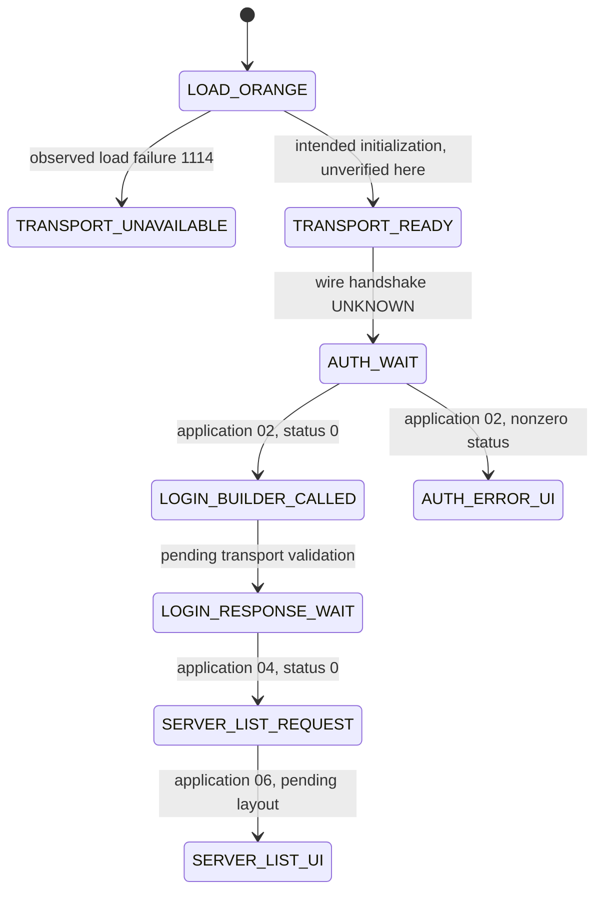

> Активная цель — вход в город.17/18/19/1A и загрузка3городов подтвержденыlive;61 unit PASS. TownInfo3C и видимыйгород ещё не восстановлены. См.[CITY_ENTRY.md](CITY_ENTRY.md).

> Диагностическое создание с SQLite и последовательностью1200→10 проверено live;gateac4c58 сброшен,59 unit tests PASS. Полные игровые правила/официальная success семантика не восстановлены. См.[CHARACTER_CREATION.md](CHARACTER_CREATION.md).

> **2026-09-12: непустой10 прошёл live после сетевой загрузки B9.** Старый NULL catalog fault устранён штатным loader; обработан Probe и подтверждён возврат CharSelectInfo. 54 unit tests PASS. Полный каталог/UI/world entry ещё не проверены. См. [SHARED_CONFIG.md](SHARED_CONFIG.md). Нижние записи FAILED относятся к предыдущим запускам.

# Session state machine — known fragment

## Последний результат: формат записи10 и найденная зависимость

CONFIRMED: полный layout непустой записи восстановлен;47 unit tests и3 native
record/catalog cases прошли. Live parser прочитал поля, но завершение10 не прошло:
при обновлении модели найден NULL в таблице [[ac637c]], fault a78b1c/address116.
Подробности — CHARACTER_RECORD.md. Следующий блокер — инициализация этой таблицы.
Непустой список и вход в мир пока не считаются успешно обработанными.

## История предыдущих этапов

## Последний результат: пустой список персонажей, 2026-09-12

CONFIRMED: S2C10 `100000` после0D проходит основной gate, вызывает
RECV_CharSelectInfo и обновление выбора персонажа, устанавливает флаг завершения.
43 unit tests и6 native parser/gate cases прошли. Повторный live run без ошибок.
Подробности — CHARACTER_SELECTION.md. Следующий шаг — полная запись персонажа
в непустом10; вход в мир ещё не выполнен.

## История предыдущих этапов

## Последний результат: application 0C/0D, 2026-09-12

CONFIRMED: оригинальный клиент принял0D00, записал сообщение об успешной
аутентификации на game server и вернулся из AuthReply2. Новых C2S bytes за2s
не было; success-ветка не вызывает packet builder. 41 unit tests и3 native0D
cases прошли. Подробности — AUTH2.md. Следующий блокер: серверная инициализация
игрового состояния, не следующий запрос клиента. Вход в мир ещё не выполнен.

## История предыдущих этапов

## Последний результат: mode1 handshake, 2026-09-12

CONFIRMED: второйsocket принял clear09, клиент ответилencrypted0A; encrypted0B00
перевёл state2→3, вызвалAuthReply1 иполученapplication0C.
37 unit tests,15 native mode1 cases и8 прежнихnative cipher cases прошли.
Подробности/исправленное сопоставлениеполей — MODE1_HANDSHAKE.md.
Следующийblocker — application0C/0D; игровойвход ещёне завершён.

## История предыдущих этапов

## Последний результат:07/08 и второе соединение, 2026-09-12

CONFIRMED: original selection71e998 → C2S07 → S2C0800 → original connect mode1
к выбранному loopback host/port; сервер принял второе TCP-соединение.
33 unit tests и3 native08 cases прошли. SERVER_LOGIN.md содержит layouts,
источники иограничения. Следующий blocker — начальный handshake режима1.
Вход вworld пока не выполнен; отсутствие bytes на новом socket наблюдалось2s.

## История предыдущих этапов

## Последний результат: список серверов06, 2026-09-12

CONFIRMED: оригинальный TI принял S2C06 с пустым списком и с одной синтетической
записью. В обоих запусках вызван SILVER87d1cc, функция обновления71e594 и возврат
из parser; в непустом случае вызван add-record71fea0. Тесты:31 unit,7 original-x86
server-list cases прошли. Форматы и ограничения — SERVER_LIST.md.
Следующий blocker: выбор сервера → C2S07 → S2C08. Вход в игровой мир не выполнен.
UI выбор не автоматизирован; connect и synthetic login заданы в owned probe.

## Предыдущие результаты (история)

## Актуальный результат 2026-09-12

CONFIRMED: оригинальный TI по TCP loopback прошёл `S2C transport00 → C2S01 →
S2C transport02 → C2S application03 → S2C application0400 → C2S application05`.
Completion `02000044332211` создаёт очередь `020044332211` и native state0→1.
Transport02 сам доставляет LSAuthResult; отдельный application02 не нужен.

Connect вызван через оригинальный экспорт. В оригинальный builder поданы
синтетические ASCII credentials `probe_user / probe_password` в памяти процесса.
Socket, cipher, parser и builder выполняются оригинальным клиентом; полный UI login
и реальная серверная аутентификация не проверены. Следующий blocker — ответ06.
26 unit tests и 9 original-x86 completion cases прошли. Evidence:
`evidence/login_success_run.log`, `evidence/native_completion_probe.json`.
Counter-dependent изменения транспорта после >5/>6 остаются UNKNOWN.

## История предыдущих этапов (содержит снятые ограничения)

Transport update: original socket loopback now confirms `TRANSPORT_READY →
WAIT_INITIAL_CHALLENGE → INITIAL_REPLY_SENT` after encrypted S2C 00 and C2S 01.
The connection is initiated through the original ORANGE export; UI action is
not exercised. Transport-completion 02 and application auth remain next steps.

| State | Allowed incoming | Allowed outgoing | Transition | Evidence | Confidence |
|---|---|---|---|---|---|
| Native transport state 0 | ORANGE 00 with length/XOR | ORANGE 01 | initial reply sent | TRANSPORT.md, live loopback | CONFIRMED |
| Reply sent | candidate ORANGE 02 | queued local event pending | state word may become1 | 0x2381 code only | UNKNOWN live transition |

Update 2026-09-12: LOAD_ORANGE → TRANSPORT_READY подтверждён в процессе с
module-slot compatibility fix (ORANGE_LOADER.md). Без исправления сохраняется
исходный сбой. Wire handshake всё ещё UNKNOWN.

Это документированная модель наблюдений, **не полная серверная FSM**.
Имена состояний ниже аналитические. Native dispatcher не проверяет ожидаемое
auth-состояние перед обработкой `02`; серверные ограничения не выдуманы.

Пунктирные/неподтверждённые связи здесь описаны словами в labels и таблице;
достижимость сетевых состояний в живом клиенте не доказана.

| State | Allowed incoming packets | Allowed outgoing packets | Transition | Evidence | Confidence |
|---|---|---|---|---|---|
| LOAD_ORANGE | none observed | none observed | load fails, no transport pointers | `ti.exe 0x718fb8`; `capture_exceptions.log`, error 1114 | CONFIRMED instrumented run |
| TRANSPORT_UNAVAILABLE | UNKNOWN | cannot send through null callback | remains disconnected | late attach: `0x78651c = 0`; module absent | CONFIRMED late snapshot; exact error not captured in late run |
| TRANSPORT_READY | UNKNOWN wire handshake | UNKNOWN | toward auth | intended loader/consumer architecture only | LIKELY |
| AUTH_WAIT | `02` dispatch supported; admission guard UNKNOWN | no wire response established | status 0 saves u32, calls normal login-builder or alternate builder | `0x87ce60`; native probe | CONFIRMED local transition only |
| AUTH_ERROR_UI | `02` with nonzero status consumed | UNKNOWN | error UI path, no login-builder call in probe | `0x87cf2a`; native probe | CONFIRMED local branch |
| LOGIN_BUILDER_CALLED | UNKNOWN | builder starts `03`/`0A` depending on flags | network send/result not validated | `0x87c604` | CONFIRMED call, UNKNOWN wire transition |
| LOGIN_RESPONSE_WAIT | `04` handled | on status 0 builder starts `05` | request list | `0x87d00c -> 0x87c76c` | CONFIRMED code path; state inferred |
| SERVER_LIST_UI | `06` handled | candidate `07` | selection then `08` candidate | dispatch table; `0x87c7b4` | STRONG relation, UNKNOWN layout |
| GAME_AUTH / WORLD | `0B`,`0D` named callbacks | candidate `0A`,`0C` | UNKNOWN | names and local builder in `0B` consumer | UNKNOWN complete lifecycle |

Native client variable at `0xac48e0`: callback `00` examines values 0, 1, 2;
callback `01` clears it. These transport events are not mapped onto raw wire
commands. Disconnect conditions, timeouts, host/port/ticket handoff and character
initialization remain UNKNOWN.
